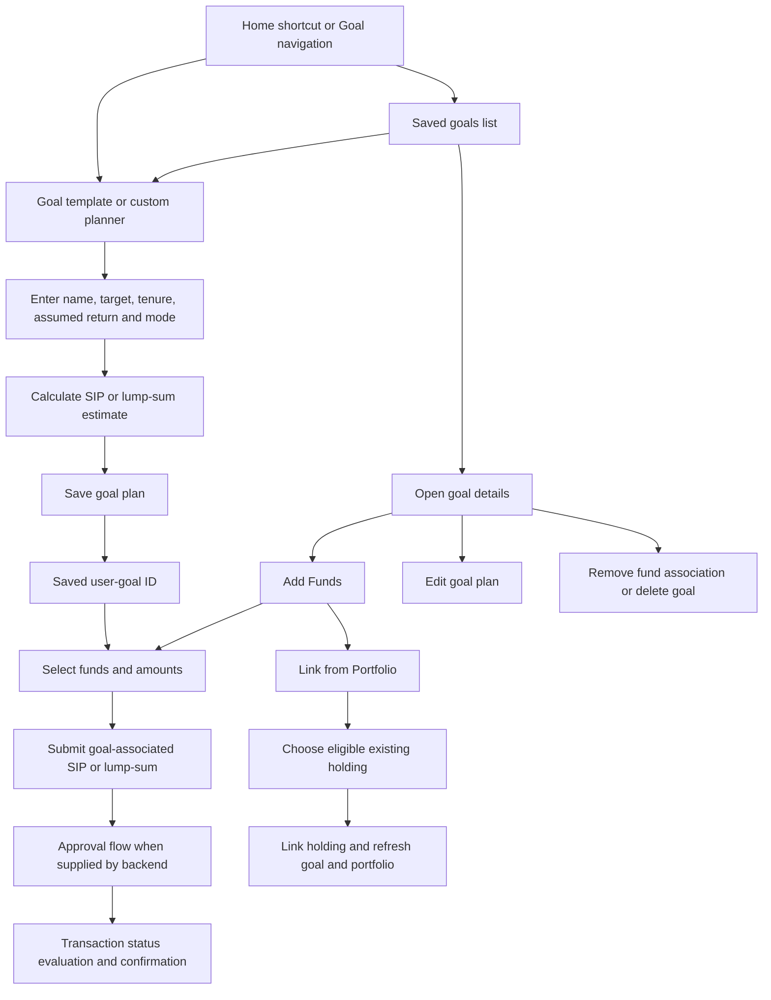

# Goal section: flow and implementation analysis

Reviewed: 6 November 2026.

This guide describes the checked-out Flutter source. It explains the current
journey, the intended sequence implied by the code, and implementation gaps.
It does not establish that the backend, investment execution, or rendered UI
works correctly. No app launch, API call, test, build, or installation was run.

## 1. What the Goal section does

A goal is a named financial target with a target amount, tenure, assumed return,
and an investment plan. The application supports SIP and lump-sum planning.

There are three separate activities:

| Activity | What it does |
| --- | --- |
| Save a goal | Stores the plan and obtains a saved user-goal ID. This alone does not submit an investment. |
| Invest for a goal | Submits selected funds through the MFU investment integration with the saved goal ID. |
| Link an existing holding | Associates an eligible portfolio holding with a goal through a separate link endpoint. It does not create a new purchase. |

The current mobile planner, web planner, and Add Funds sheet submit investments
directly through `MfuController.postSip()` / `postLumpsum()`. An older goal-aware
cart journey also remains in the codebase. These paths should be distinguished
when debugging the feature.

## 2. Main user journey



This diagram describes the overall sequence. The prerequisite gate is wired
into the mobile planner and Add Funds sheet; the web planner differs, as noted
in the findings section. A confirmation screen is not proof of settled units.
Actual investment/allotment and redemption statuses come from the integrations.

## 3. Entry points and routes

Navigation definitions are in [app_routes.dart](../lib/config/routes/app_routes.dart),
[app_pages.dart](../lib/config/routes/app_pages.dart), and
[navigation_menu_bar.dart](../lib/navigation_menu_bar.dart).

| Route / entry | Screen or action |
| --- | --- |
| Goal navigation, index `3` | Opens `GoalScreen`, with mobile/web layouts for saved goals. |
| `/goalScreen` | Saved-goal listing; loading shimmer, empty state, create action, and goal cards. |
| `/masterGoalsPage` | `MasterGoalsPage`: mobile-oriented template grid and planning screen. |
| `/webMasterGoalsPage` | `UnifiedGoalDashboard`, defined in `web_master_goals_view.dart`. |
| `/goaldetails` | `GoalDetailsPage`: live saved-goal details, edit/delete, linked funds, and Add Funds. |
| `/ihavegoal` | Retained `IhavegoalPage` planning/cart flow. |
| `/successfullcreategoal` | `GoalsuccessPage`; its Continue action uses a supplied next route or defaults to the comparison route. This is separate from investment confirmation. |
| `/goalviewcard` | Retained goal entry/empty-state page linking to the template planner. |
| Home goal shortcuts | Pass `goalType` and `isHome` to the appropriate planner. |
| Home active-goal cards | Open saved-goal details; refresh the goal list after returning. |

On web, the route registry wraps nested pages in `NavigationMenuBar`; many
screen transitions use navigator `id: 1`. Mobile transitions generally use the
root navigator. Home active-goal navigation is implemented in
[home_active_goals.dart](../lib/features/home/presentation/widgets/home_active_goals.dart).

### Important screen-name distinction

- `GoalDetailsScreen` in `master_goals_page.dart` is a **planner**.
- `GoalDetailsPage` in `goaldetails.dart` is a **saved-goal dashboard**.
- `/webMasterGoalsPage` currently registers `UnifiedGoalDashboard` from
  `web_master_goals_view.dart`. `WebMasterGoalsPage` in
  `web_master_goals_pages.dart` is another retained implementation, not the
  page registered for that route.

## 4. Architecture and dependency registration

```text
Page / Widget
  -> GoalSipController
  -> GoalUseCases
  -> GoalRepository
  -> GoalRepositoryImpl
  -> GoalRemoteDataSource
  -> NetworkServicesApi
  -> Application backend
```

[GoalBinding](../lib/features/goal/presentation/bindings/goal_binding.dart)
registers the remote source, repository implementation, individual use cases,
`GoalUseCases`, and `GoalSipController` using `Get.lazyPut(..., fenix: true)`.
The shell and goal routes reference this binding. The network service must
already be registered. Related screens also retrieve the mutual-fund, cart,
MFU, dashboard, and personalization controllers through GetX.

[GoalRepositoryImpl](../lib/features/goal/data/repositories/goal_repository_impl.dart)
converts response models into domain entities. The result convention is
`Either<Result<T>, ApiError>` with **Left = success** and **Right = failure**.

### Controller state to understand

Source: [GoalSipController](../lib/features/goal/presentation/controller/goal_sip_controller.dart).

| State | Meaning |
| --- | --- |
| `masterGoals` | Backend goal templates and associated template metadata. |
| `goalResponse` | The user's saved goals. |
| `currentGoalDetail` | Live detail response for a saved goal. Consumers should check that its ID matches the displayed goal. |
| `goalId` | Selected master/template ID used when creating a plan. |
| `savedDatabaseId` | Saved user-goal record ID returned after creation. Used for investment association. |
| `investmentMode` | Current planner mode: `sip` or `lumpsum`. |
| `savedInvestmentType` | Mode of the saved plan, used by planner submission branches. |
| `isEdit`, `isHome`, `isAddFund` | Entry mode controlling planner initialization and presentation. |
| `isGoalSaved`, `hasChanges` | Control save/update controls and fund-selection visibility. |
| `selectedPopularFund` | Planner fund selection stored by base scheme name. |
| `amountControllers` | Per-scheme amount inputs, keyed by scheme code. |
| `isLoadingGoals`, `isMasterGoalLoading`, `isLoadingSingleGoal` | Separate request/loading indicators. |

**ID distinction:** a master-template ID and a saved user-goal ID are different
concepts. Creating a plan sends the template ID in `goal_id`; later investment
and portfolio-link calls require the saved user-goal ID in their goal context.

## 5. Loading goals and choosing a template

`GoalSipController.onInit()` starts loading user goals and master templates, then
calculates initial estimates. `GoalScreen.build()` also schedules a user-goals
refresh after the frame. The web planner's `initializeDashboardData()` loads
both user goals and master templates.

1. Read user goals and show a shimmer while loading.
2. Show the empty-state creation action if no goals are available.
3. On Create New Goal, reset planner state and load master templates.
4. Select a template or custom/other goal.
5. Initialize the name, target, tenure, and assumed return from the selected
   master template. Home shortcuts can initialize the matching template directly.
6. Adjust SIP/lump-sum mode and planning inputs.

The controller also has a local `goalConfig` mapping for several goal types.
It is a fallback/configuration path, not a substitute for the master endpoint.
For example, the local map does not cover every type recognized by the icon
helpers. Template IDs and defaults should be checked against the backend.

Sources:
[goal.dart](../lib/features/goal/presentation/pages/goal.dart),
[master_goals_page.dart](../lib/features/goal/presentation/pages/master_goals_page.dart),
[web_master_goals_view.dart](../lib/features/goal/presentation/pages/web_master_goals_view.dart),
[get_goal_master_model.dart](../lib/features/goal/data/model/get_goal_master_model.dart).

## 6. Planning calculations as currently implemented

These are descriptions of existing code, not validated financial forecasts.
Expected returns are planning inputs, not guaranteed returns.

### SIP estimate

In `_effectiveMonthlyRate()` and `_recalculate()`:

```text
annual = annualRate / 100
monthlyRate = (1 + annual)^(1/12) - 1
months = round(years * 12)
factor = (((1 + monthlyRate)^months - 1) / monthlyRate) * (1 + monthlyRate)
exactMonthlySip = targetAmount / factor
monthlySip = ceil(exactMonthlySip / 100) * 100
```

There is a zero-rate formula branch that divides target by months. However,
`setRate()` substitutes 12% for a non-positive input and otherwise clamps it
to 1%-30%, so normal setter-based input does not expose a zero-rate plan.

The recurrence is `(value + monthlySip) * (1 + monthlyRate)`, corresponding to
the contribution occurring before that period's growth. `invested` is the
calculated total of scheduled contributions. `futureValue` is rounded to a
multiple of 10. `totalReturn` uses **target minus invested**, which can differ
from calculated future value minus invested after SIP rounding.

Weekly/daily figures are display estimates using monthly SIP divided by 4 and
30. The goal investment submission still uses monthly frequency `M`.

### Lump-sum estimate

```text
principal = targetFutureValue / (1 + annualRate / 100)^integerYears
lumpsumAmount = ceil(principal / 100) * 100
```

`recalculateLumpsum()` truncates years to an integer. It rounds the displayed
return amount to a multiple of 10 and stores total return/principal as
`lumpsumReturnPercent`.

`smartRoundOff()` also rounds targets at different magnitudes: nearest 100,
1,000, 10,000, or 100,000. This affects model inputs, not just text formatting.

### Reports and edit-dialog differences

- `buildYearlyReport()` simulates 12 monthly contributions per displayed year.
- `buildLumpsumYearlyReport()` compounds `lumpsumReturnPercent` as though it
  were an annual rate, even though the calculator stores an aggregate return
  percentage there. This needs financial-calculation review.
- The saved-goal edit dialog has its own SIP calculation and rounds to the
  nearest 10, while the new-goal controller rounds up to 100.
- The edit dialog sends tenure in months. Loading code uses a heuristic:
  values above 30 are divided by 12; smaller positive values are treated as years.

Sources: controller calculation/report methods and
`_EditGoalSheetContentState` in
[goaldetails.dart](../lib/features/goal/presentation/pages/goaldetails.dart).

## 7. Saving a goal plan

`saveGoalToDb()` validates the goal name and sends the following fields through
`SaveGoalUseCase` to `POST /api/v1/goals`:

| Field | Current source |
| --- | --- |
| `user_id` | Current session user ID. |
| `goal_name` | Trimmed name input. |
| `goal_id` | Selected master/template ID. |
| `target_amount` | SIP target or lump-sum future-value target. |
| `frequency` | Literal `Monthly`. |
| `monthly_investment` | Calculated monthly SIP for SIP mode, otherwise zero. |
| `expected_return_rate` | Planner annual-rate input. |
| `goal_tenure` | `(years * 12).toInt()`. |
| `invested_amount` | Calculated total scheduled SIP contributions; zero for lump sum. |
| `txn_type` | Lowercase planner mode. |
| `lumpsum_amount` | Planned lump-sum amount for that mode, otherwise zero. |
| `status` | Literal `pending`. |
| `created_date` | Client `DateTime.now().toString()`. |

On success, the controller refreshes fund discovery and user goals, marks the
plan saved, and stores the returned `data.id` and `data.txnType`. Fund discovery
uses `return_max`, `sort_order: desc`, and `return_year` filters in `fetchCount()`.

The client does not include the selected cover image in this request. Picking
an image currently changes local `coverImage` state only.

**Current defect:** error and exception branches also set `isGoalSaved = true`.
Consequently that flag is not reliable evidence of successful persistence.
The planner can reveal investment controls without a valid saved ID; its
submission code converts a missing/invalid ID to null, which omits `goal_id`
from the MFU request. Whether the backend rejects such a purchase is unverified.

## 8. Investing new money for a goal

### A. Planner submission

The mobile planner and `UnifiedGoalDashboard`:

1. Select funds from the shared mutual-fund discovery controller.
2. Store selections by base scheme name and amount inputs by scheme code.
3. Distribute the plan amount or accept edited per-fund amounts.
4. Resolve `savedDatabaseId` into the goal association ID.
5. Build a list of funds with nonempty scheme codes and positive amounts.
6. Submit directly to `MfuController.postSip()` or `postLumpsum()`.

The controller's distribution helpers primarily update local amount inputs.
Some construct request maps without persisting them; redistribution persistence
calls are commented out. They should not be treated as completed investments.
Amounts are initially split in 100-unit blocks, with a remainder assigned to
the last fund. Edited redistribution uses different rounding rules.

### B. Add Funds from a saved goal

[AddFundBottomSheet](../lib/features/goal/presentation/widget/add_fund_bottom_sheet.dart)
opens as a bottom sheet on mobile and a dialog on desktop. Its tabs are:

- Monthly SIP.
- One-Time Lumpsum.
- Link from Portfolio.

The new-investment tabs use scheme-code selections and a separate selected-fund
map. They validate per-fund minimum amounts using discovery metadata, with
fallbacks of 500 for SIP and 1,000 for lump sum when valid metadata is absent.
These are current client fallback values, not independently verified provider rules.

Switching modes raises amounts below the new minimum. Search/filtering and
pagination use the shared discovery controller; closing the sheet resets its
filters. Submission uses `widget.goalId`. The SIP day is currently hardcoded
to `"10"`, unlike the planner's `selectedSipDay`.

### C. Prerequisites

[GatekeeperHelper](../lib/core/utils/helper/purchase_scenario.dart) checks:

1. KYC approved/verified.
2. Additional personal details complete.
3. Bank account present.
4. CAN present and approved/active.
5. Approved Auto Pay mandate for SIP. Lump sum bypasses the mandate requirement.

The mobile planner and Add Funds sheet call this gate. The inspected web
planner submission calls the MFU methods directly. The `postSip()` and
`postLumpsum()` alias methods themselves do not apply this gate. This is a
frontend consistency gap; backend validation was not inspected.

### D. Investment API payload and confirmation

| Operation | Endpoint and fields |
| --- | --- |
| SIP | `POST /api/v1/invest/sip`: optional top-level `goal_id`; `funds[]` with `scheme_code`, `amount`, `folio`, `frequency`, `day`, and optional `devopt`. |
| Lump sum | `POST /api/v1/invest/lumpsum`: optional top-level `goal_id`; `funds[]` with `scheme_code`, `amount`, `folio`, and optional `devopt`. |

The inspected goal submitters use `folio: NEW`; SIP uses frequency `M`.
The controller creates the request model, calls the MFU use case, handles an
approval link when supplied, evaluates transaction status, and navigates to
the payment-confirmation route with order/status summary information.

The investment API accepts a goal association; creating that server-side
association and updating settled goal balances are backend responsibilities
that were not verified by this source review.

Sources:
[MFU controller](../lib/features/mfu/presentation/controller/mfu_controller.dart),
[MFU remote source](../lib/features/mfu/data/datasource/mfu_remote_data_source.dart),
[SIP request model](../lib/features/mfu/data/model/sip_req_model.dart),
[lump-sum request model](../lib/features/mfu/data/model/lumpsum_req_model.dart).

## 9. Linking an existing portfolio holding

This journey makes an association without submitting a new investment.

1. Open Add Funds -> Link from Portfolio.
2. Load the dashboard portfolio.
3. Display holdings with positive finite value and units, excluding fully
   redeemed, redemption-pending, allotment-pending, and already associated holdings.
   Linking also requires a positive actual `mfuOrderId`.
4. Exclude schemes already linked to a goal, including another holding/folio
   of the same normalized scheme code.
5. Disable duplicate submissions by pending holding ID and scheme code.
6. Call `POST /api/v1/goal/{goalId}/link-fund` with `mfu_order_id`.
7. After confirmation, mark the holding linked locally, then refresh portfolio,
   single-goal details, and the user-goal list.

The request's `mfu_order_id` comes directly from `holding.mfuOrderId`, as
confirmed by the requested integration correction. A missing or nonpositive
order ID prevents linking; the API value does not fall back to `mfuOrderFundId`.
For example, a holding with `mfu_order_id: 362` and `mfu_order_fund_id: 431`
sends `{"mfu_order_id": 362}`. This request has not been verified against the
live backend.

Internal loading, duplicate protection, and local portfolio updates continue
using `holding.goalLinkId`, which prefers a positive parsed `mfuOrderFundId`
and otherwise uses `mfuOrderId`. Keeping these identifiers separate preserves
the existing fund-level tracking when multiple funds share an order.

The tab preserves the locally confirmed association if a follow-up refresh
fails, reducing accidental resubmission. The controller also maintains
`linkingFundMap` and `linkingSchemeCodes`. Backend uniqueness/idempotency remains
an external requirement rather than an outcome established by these UI guards.

Sources:
[goal_portfolio_link_tab.dart](../lib/features/goal/presentation/widget/goal_portfolio_link_tab.dart),
controller `canLinkPortfolioFund()` / `linkFundToGoal()`, and
[portfolio_entity.dart](../lib/features/dashboard/domain/entity/portfolio_entity.dart).

## 10. Saved-goal dashboard and progress

[GoalDetailsPage](../lib/features/goal/presentation/pages/goaldetails.dart)
resolves the saved ID from a supplied goal entity, `goalId` argument, or `id`
route parameter. It requests single-goal details and prefers a response whose
ID matches the displayed goal. It falls back to supplied/list data as needed.

The detail model includes goal identity, target, saved/remaining amounts,
progress, deadline/savings information, linked funds, fund transactions, and
redemption details. It accepts several alternate field shapes, including:

- `saved_amount` / `saved` and nested `saving.saved`.
- `remaining_amount` / `remaining` and nested `saving.remaining`.
- `target_amount` / `goal` and nested `saving.goal`.
- Flat deadline/savings fields with nested `deadline` fallbacks.

Source: [single_goal_detail_model.dart](../lib/features/goal/data/model/single_goal_detail_model.dart).

The shared progress helper prefers a positive finite backend `progressPercent`;
otherwise it calculates invested/target, then clamps the displayed ratio to
0..1. List cards may derive invested from target times progress when an invested
amount is unavailable. The live dashboard prefers backend `savedAmount`.

Source: [goal_progress_indicator.dart](../lib/features/goal/presentation/widget/goal_progress_indicator.dart).

### Transactions and redemption presentation

- Mobile `GoalRecordTab` gathers transactions from live linked funds, merges
  redemption details missing from the transaction list, deduplicates those by
  reference/GORN, sorts newest first, and filters All/SIP/Lumpsum/Redeem.
- Desktop `RecentContributionsCard` still contains sample dates/rows. It is
  not equivalent to the live mobile transaction tab.
- Tapping a linked fund opens the portfolio fund-details modal. Redemption
  warns when a holding is goal-linked and carries goal context into the redeem
  page. Redemption-pending/redeemed labels are displayed from returned data.
- Removing a fund association and redeeming units are separate actions.

Related source:
[portfolio fund-details modal](../lib/features/dashboard/presentation/widgets/portfolio_fund_details_modal.dart),
[redeem page](../lib/features/mfu/presentation/pages/redeem_page.dart).

## 11. Edit, remove, and delete

### Edit the saved plan

The current goal-detail page opens an in-context edit dialog on desktop or a
sheet on mobile. It validates the name, calculates a revised monthly estimate,
and calls `updateGoalDetails()`.

The update sends name, target, assumed return, and positive optional monthly
investment/tenure to `POST /api/v1/goals/{goalId}`. On success it refreshes live
detail and the user-goal list, then closes the edit UI.

Both edit layouts show the existing goal cover and an Add/Change image action.
The editor keeps the selected `XFile` and its byte preview locally, so cancelling
does not change shared new-goal cover state. Cancelled picks retain the previous
selection; empty, unreadable, or undecodable images are rejected. Saving is
disabled while an image is being read or an update is in progress.

Without a replacement image, the existing JSON update is preserved and no
`goal_cover` field is sent. With a replacement, the same POST endpoint receives
multipart form data: existing goal fields as text and a binary `goal_cover`
file. This uses the shared multipart uploader, without a method override or
an image-removal field. Upload failures retain the editor and selection for retry.
After success, affected cover URLs are evicted from the image cache on a
best-effort basis and the refreshed goal state is notified. Browser caching
and already displayed resized images can still depend on the backend returning
a new image URL or suitable cache headers. Live multipart acceptance and
rendered mobile/web behavior have not been verified.

Updating a goal plan is not shown calling an MFU SIP-amendment endpoint. It
should not be described as automatically changing an existing bank debit/SIP.
Older planner Update Goal handlers still contain commented-out calls.

### Remove a linked fund

After confirmation, `deleteGoalFund()` calls `DELETE /api/v1/goal-fund/{id}`,
updates local associations, and refreshes goal details/list data. This client
action does not call a redemption endpoint.

### Delete a goal

After confirmation, `deleteGoal()` calls `DELETE /api/v1/goal/{id}`, refreshes
the list, and navigates back. No SIP-cancellation or redemption request is made
in this handler. Backend cascade/unlink behavior is unknown from this client.

## 12. Goal API inventory

All paths are relative to the application's configured backend base URL.
Goal remote-source requests explicitly use the current session bearer token;
credentials and example investor records are intentionally omitted here.

| Method | Path | Use and response handling in client |
| --- | --- | --- |
| GET | `/api/v1/goal/master` | Templates; requires `status == true`; parses list from `data`. |
| GET | `/api/v1/goals/user/{userId}` | Saved goals; accepts `success` or `status`; `GoalResponseModel` reads the list from the **`goal`** key. |
| POST | `/api/v1/goals` | Save plan; accepts `success` or `status`; parses created record from `data`. |
| GET | `/api/v1/goal/{id}` | Single-goal dashboard; accepts `success` or `status`; parses `data`. |
| POST | `/api/v1/goals/{goalId}` | Update plan; accepts `success` or `status`. |
| DELETE | `/api/v1/goal/{id}` | Delete goal; deletion response model requires `status`. |
| DELETE | `/api/v1/goal-fund/{id}` | Remove association; deletion response model requires `status`. |
| POST | `/api/v1/goal/{goalId}/link-fund` | Link existing holding; body `mfu_order_id`; accepts `success` or `status`. |
| POST | `/api/v1/goal-orders/save` | Retained fund-association helper path; requires `status`. |
| POST | `/api/v1/goal-orders` | Retained goal-fund order path; requires `success`; parses `data`. |
| PATCH | `/api/v1/goal-fund` | Bulk fund update body `{ "funds": [...] }`; requires `status`. The remote method's `fundId` parameter is not included in the URL. |

Source: [goal_remote_data_source.dart](../lib/features/goal/data/datasource/goal_remote_data_source.dart).
These are implemented client paths and parsing expectations, not a verified
backend API specification.

### Retained helper naming can be misleading

`SaveGoalFundUseCase` in `save_goal_to_fund.dart` calls repository
`saveGoalFund()`, which calls remote `saveGoalToFund()` -> `/goal-orders/save`.
`GoalFundOrderUseCase` calls repository `saveGoalFundOrder()`, which calls remote
`saveGoalFund()` -> `/goal-orders`. The active planner/Add Funds investment
buttons use the investment endpoints instead.

## 13. Older cart flow

`IhavegoalPage` retains fund-card calls to `CartController.addToCart()` with a
goal ID and later opens the cart. The cart identifies duplicates by scheme,
goal, and transaction type; `displayedItems` filters by `filterGoalId`.

Its argument loader only restores `goal_id` when `isFromGoal == true`. The
inspected older goal navigation sets controller state but passes an argument
map containing only `goal_id`. Therefore goal-filter restoration should be
checked before relying on this journey. The active direct-MFU planner path
does not use the cart as an intermediate checkout screen.

Sources:
[ihavegoal.dart](../lib/features/goal/presentation/pages/ihavegoal.dart),
[cart_controller.dart](../lib/features/cart/presentation/controllers/cart_controller.dart).

## 14. Observed gaps and review priorities

These are source findings, not reproduced runtime failures. No fixes were made
as part of this documentation task.

| Priority | Finding | Practical implication / review needed |
| --- | --- | --- |
| High | Save failure sets `isGoalSaved = true`; investment callers can turn an invalid saved ID into null. | Require successful persistence and a positive saved ID before investing for a goal. Verify backend association enforcement. |
| High | The web planner lacks the prerequisite gate used by mobile/Add Funds. | Align prerequisite coverage; backend checks are unverified. |
| High | Tenure is saved as months but loaded with the `> 30` heuristic. | For example, a returned value of 12 months can be interpreted as 12 years. Confirm units and normalize explicitly. |
| High | New-plan SIP, edit-dialog SIP, and lump-sum yearly reports use different rounding/rate semantics. | Review formula consistency, integer/fractional tenure handling, and report totals before financial sign-off. |
| High | Create payload `invested_amount` uses projected scheduled contributions, while detail UI uses saved balances. | Confirm backend meaning; planned contributions must not be mistaken for settled holdings. |
| Medium | Add Funds SIP day is `10`; planner uses selected day. | Validate against scheme-allowed SIP dates and make behavior consistent. |
| Medium | Planner selection uses fund names and resolves against the current discovery results. | Filtering/pagination or duplicate base names can affect selection resolution; preserve stable scheme identity. |
| Medium | Distribution can force at least 100 per fund and then adjust the last amount by the remainder. | Small totals/many funds can produce invalid allocations; per-scheme thresholds need consistent validation. |
| Medium | Older planner Update Goal calls are commented out; the in-context detail editor is implemented. | Users can encounter different edit behavior depending on entry path. |
| Medium | Desktop contributions use sample rows; mobile records use live transactions. | Desktop history is not currently authoritative. |
| Medium | GoalScreen requests data from `build`; several entry points also fetch on initialization. | Duplicate requests and shared loading-state races are possible. |
| Medium | Static `tempArgs`/`tempData` and argument-only navigation carry goal context. | Browser reload/direct URL/back behavior needs review with explicit saved IDs. |
| Medium | Single-goal fetch failure returns null and does not clear prior detail; mutations refresh asynchronously. | Consumers must retain ID checks and communicate errors; some handlers clear flags before asynchronous refresh completes. |
| Medium | Cover picking has no upload/create-payload integration. | A selected cover is not established as persisted. |
| Medium | Retained `saveFundToGoal()` has a hardcoded fallback user ID and converts all API errors to an Already in Goal message. | Avoid reusing this path without identity/error-handling review. No active page caller was found in the search. |
| Medium | Fund/goal handlers log payloads and responses; backend authorization/idempotency was not inspected. | Review logging and server-side authorization/uniqueness before production use. |
| Low | Reset clears `amountControllers` without disposing entries; `onClose` disposes only entries still in the map. The web planner creates a scroll controller in `build`. | Review controller/widget resource lifecycle. |

## 15. What a consistent flow should preserve

The intended sequence implied by the existing integration is:

1. Load server templates and the current user's saved goals.
2. Initialize a fresh plan or load the correct saved-goal context.
3. Calculate planning estimates with clearly defined units and rounding.
4. Persist the plan and retain its confirmed saved ID.
5. Choose either new investment or association of an existing eligible holding.
6. For new investment, enforce prerequisites, fund eligibility, amount and SIP
   date rules, then submit with the saved goal ID.
7. Handle approval, failure, pending processing, and refreshed server balances.
8. Render goal progress/history from matching live data with explicit fallbacks.
9. Treat plan editing, unlinking, deleting, SIP amendment, and redemption as
   separate operations with their existing API responsibilities.

This is an implementation-review sequence, not a proposal for new API fields or
unconfirmed business rules.

## 16. Verification and scope of this analysis

- Reviewed route registry/shell integration, bindings, main screens, controller,
  use cases, repository, remote source, response models, portfolio linking,
  cart context, prerequisite helper, MFU request models, and investment handlers.
- Cross-checked active call sites against commented/retained implementations.
- Documentation file references and whitespace were checked during creation.
- No application source, dependencies, routes, configuration, formulas, or
  backend state were modified.
- No tests, builds, installation, runtime navigation, live API calls, payment
  approvals, KYC checks, or financial calculation validation were performed.

Runtime validation remains necessary for authenticated loading/error states,
save-failure gating, mobile/web parity, ID/tenure persistence, minimum amounts
and SIP dates, browser refresh/back, duplicate submission, settled progress,
redemption updates, and backend link/delete semantics.
