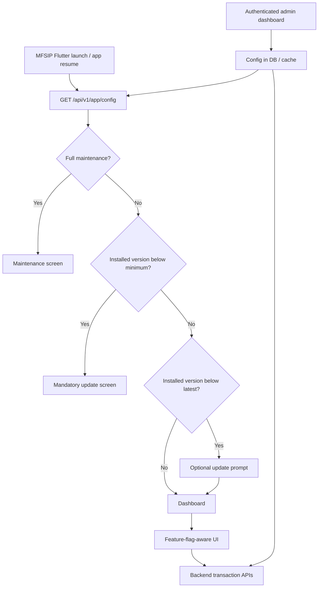

# MFSIP — App Version Updates, Maintenance Mode & Feature Controls

> **Implementation guide** for the MFSIP Flutter application (Android, iOS, and Web) and its backend.
>
> **Status:** Developer handoff / implementation blueprint  
> **Updated:** 03 November 2026  
> **Assumption:** MFSIP already has a backend API. Laravel/PHP snippets are examples; adapt them if your backend uses another framework.

## 1. What we are building

Allow an administrator to control app availability **without publishing a new Flutter build** for every message or outage.

| Function | User experience | Server-side action |
|---|---|---|
| Mandatory update | Full-screen “Update required” with **Update Now** | Enforce supported-client policy on applicable APIs |
| Optional update | “Update Now” or **Later** | Informational |
| Full maintenance | Full-screen “Under maintenance” with **Retry** | Temporarily reject affected requests |
| Scheduled maintenance | Banner before the window; maintenance screen during it | Server activates restrictions at scheduled times |
| Feature-level maintenance | Disable SIP, redemption, payments, etc. with explanatory messages | Reject corresponding transactions |
| Announcement | Banner or in-app dialog | Informational |
| Flutter Web upgrade | “New version available — Reload” | Deploy assets with correct caching strategy |

**Key rule:** Flutter handles the **user interface**. The backend is the **source of truth** for whether an investment, redemption, or payment operation is permitted. A hidden button is not a security control.

## 2. Architecture



**Suggested project structure:**

```text
lib/
  core/
    app_config/
      app_config_service.dart
      app_gate.dart
      app_feature_guard.dart
  screens/
    maintenance_screen.dart
    update_required_screen.dart
    optional_update_dialog.dart
```

Suggested backend structure (Laravel example):

```text
app/Http/Controllers/Api/AppConfigController.php
app/Http/Controllers/Admin/AppConfigAdminController.php
app/Http/Middleware/EnforceRuntimeRestrictions.php
app/Services/AppConfigService.php
routes/api.php
```

## 3. Recommended backend API

### 3.1 Public configuration endpoint

```http
GET /api/v1/app/config
Accept: application/json
```

- Make it available **before authentication** and **during maintenance**.
- Use a short server-side cache (for example 30 seconds); return a sensible `Cache-Control` header so a full outage notice is not indefinitely cached.
- Rate-limit as appropriate for a public endpoint.
- Return **effective** maintenance status computed by the server; do not rely on the device clock to decide whether maintenance has started.
- Never place credentials, internal notes, or admin-only information in this response.

**Example response** (all version numbers and store URLs below are placeholders):

```json
{
  "success": true,
  "data": {
    "revision": 12,
    "checked_at": "2026-11-03T04:30:00Z",
    "refresh_after_seconds": 300,
    "maintenance": {
      "enabled": false,
      "title": "MFSIP is under maintenance",
      "message": "We are improving our services. Please try again shortly.",
      "starts_at": null,
      "ends_at": null,
      "retry_after_seconds": 180
    },
    "android": {
      "latest_version": "1.7.0",
      "minimum_version": "1.6.0",
      "store_url": "https://play.google.com/store/apps/details?id=YOUR_PACKAGE_ID"
    },
    "ios": {
      "latest_version": "1.7.0",
      "minimum_version": "1.5.0",
      "store_url": "https://apps.apple.com/app/idYOUR_APP_ID"
    },
    "web": {
      "build_id": "2026-11-03-01",
      "reload_recommended": false
    },
    "features": {
      "sip_enabled": true,
      "redeem_enabled": true,
      "payment_enabled": true,
      "new_investment_enabled": true
    },
    "announcement": {
      "enabled": false,
      "id": null,
      "title": "",
      "message": ""
    }
  }
}
```

**Field rules:**

- `minimum_version`: older installed versions are blocked.
- `latest_version`: older but still supported versions get an optional update prompt.
- Compare full semantic versions, not strings (for example, `1.10.0` is newer than `1.9.0`).
- `maintenance.enabled` is the server-computed **currently active** state. Dates are shown to the user when available.
- `features` are UX hints; backend endpoints **must separately enforce** them.
- Version fields refer to **published and available releases**, not a version merely uploaded for review.
- Return a stable `revision` or ETag to support caching / auditing.

### 3.2 Precedence

For a normal app entry point:

1. Full maintenance → maintenance screen.
2. Installed version below minimum → force-update screen.
3. Installed version below latest → optional update prompt.
4. Otherwise → dashboard, with individual feature restrictions and announcements.

During an in-progress payment or investment flow, **do not abruptly replace the payment view**; preserve transaction state and reconcile the outcome from the backend before navigating.

### 3.3 Example errors from protected APIs

Feature unavailable:

```http
HTTP/1.1 503 Service Unavailable
Retry-After: 180
Content-Type: application/json
```

```json
{
  "success": false,
  "code": "FEATURE_UNAVAILABLE",
  "message": "Redemption is temporarily unavailable.",
  "retryable": true
}
```

Unsupported app release:

```json
{
  "success": false,
  "code": "APP_UPDATE_REQUIRED",
  "message": "Please update MFSIP to continue.",
  "minimum_version": "1.6.0"
}
```

For unsupported versions, select an HTTP status such as `426 Upgrade Required` and make sure the Flutter HTTP client consistently handles the error code. Do **not** use a generic `500` for expected restrictions.

## 4. Flutter — dependencies

From the Flutter project root:

```bash
flutter pub add http package_info_plus pub_semver url_launcher
```

- `http`: read the config API.
- `package_info_plus`: installed version (`PackageInfo.version`) and optional build number.
- `pub_semver`: semantic version comparison.
- `url_launcher`: open the Play Store / App Store.

> Check package SDK compatibility before upgrading dependencies in an existing MFSIP project. In particular, newer `package_info_plus` releases may require a newer Flutter/Dart/Android toolchain.

## 5. Flutter — config service

Create `lib/core/app_config/app_config_service.dart`:

```dart
import 'dart:convert';

import 'package:flutter/foundation.dart';
import 'package:http/http.dart' as http;
import 'package:package_info_plus/package_info_plus.dart';
import 'package:pub_semver/pub_semver.dart';

enum AppStatus { normal, optionalUpdate, forceUpdate, maintenance }

class AppDecision {
  final AppStatus status;
  final String message;
  final String? title;
  final String? storeUrl;
  final Map<String, bool> features;
  final Map<String, dynamic> announcement;

  const AppDecision({
    required this.status,
    required this.message,
    required this.features,
    required this.announcement,
    this.title,
    this.storeUrl,
  });

  bool featureEnabled(String key) => features[key] ?? false;
}

class AppConfigService {
  final http.Client _client;
  final Uri endpoint;

  AppConfigService({http.Client? client, required this.endpoint})
      : _client = client ?? http.Client();

  Future<AppDecision> check() async {
    final response = await _client.get(
      endpoint,
      headers: {'Accept': 'application/json'},
    ).timeout(const Duration(seconds: 10));

    if (response.statusCode != 200) {
      throw Exception('Config request failed: ${response.statusCode}');
    }

    final payload = jsonDecode(response.body) as Map<String, dynamic>;
    if (payload['success'] != true || payload['data'] is! Map) {
      throw const FormatException('Invalid config response');
    }

    final data = Map<String, dynamic>.from(payload['data'] as Map);
    final flags = Map<String, dynamic>.from(data['features'] as Map);
    final features = flags.map(
      (key, value) => MapEntry(key, value == true),
    );
    final announcement = Map<String, dynamic>.from(
      data['announcement'] as Map,
    );
    final maintenance = Map<String, dynamic>.from(
      data['maintenance'] as Map,
    );

    if (maintenance['enabled'] == true) {
      return AppDecision(
        status: AppStatus.maintenance,
        title: maintenance['title'] as String?,
        message: maintenance['message'] as String? ??
            'Service is temporarily unavailable.',
        features: features,
        announcement: announcement,
      );
    }

    // Web uses deployment/build checks rather than mobile store links.
    if (kIsWeb) {
      return AppDecision(
        status: AppStatus.normal,
        message: '',
        features: features,
        announcement: announcement,
      );
    }

    final String platform;
    if (defaultTargetPlatform == TargetPlatform.android) {
      platform = 'android';
    } else if (defaultTargetPlatform == TargetPlatform.iOS) {
      platform = 'ios';
    } else {
      // Extend this policy when distributing desktop builds.
      return AppDecision(
        status: AppStatus.normal,
        message: '',
        features: features,
        announcement: announcement,
      );
    }

    final platformConfig = Map<String, dynamic>.from(
      data[platform] as Map,
    );
    final packageInfo = await PackageInfo.fromPlatform();
    final current = Version.parse(packageInfo.version);
    final minimum = Version.parse(
      platformConfig['minimum_version'] as String,
    );
    final latest = Version.parse(
      platformConfig['latest_version'] as String,
    );
    final storeUrl = platformConfig['store_url'] as String?;

    if (current < minimum) {
      return AppDecision(
        status: AppStatus.forceUpdate,
        title: 'Update required',
        message: 'Please update MFSIP to continue securely.',
        storeUrl: storeUrl,
        features: features,
        announcement: announcement,
      );
    }

    if (current < latest) {
      return AppDecision(
        status: AppStatus.optionalUpdate,
        title: 'Update available',
        message: 'A new version of MFSIP is available.',
        storeUrl: storeUrl,
        features: features,
        announcement: announcement,
      );
    }

    return AppDecision(
      status: AppStatus.normal,
      message: '',
      features: features,
      announcement: announcement,
    );
  }

  void dispose() => _client.close();
}
```

**Production notes:** Keep the last validated config in local storage if you want offline usability. Never allow stale local flags to authorize financial operations; the backend makes the final decision. For malformed config or the **first** failed fetch, show a retry/error view rather than silently assuming all systems are available.

## 6. Flutter — gate screen and lifecycle refresh

Create `lib/core/app_config/app_gate.dart`:

```dart
import 'dart:async';

import 'package:flutter/material.dart';
import 'package:url_launcher/url_launcher.dart';

import 'app_config_service.dart';

class AppGate extends StatefulWidget {
  const AppGate({
    super.key,
    required this.service,
    required this.dashboard,
  });

  final AppConfigService service;
  final Widget dashboard;

  @override
  State<AppGate> createState() => _AppGateState();
}

class _AppGateState extends State<AppGate> {
  AppDecision? _decision;
  String? _error;
  bool _checking = false;
  bool _skipOptionalUpdate = false;
  Timer? _timer;
  AppLifecycleListener? _lifecycle;

  @override
  void initState() {
    super.initState();
    _refresh();
    _lifecycle = AppLifecycleListener(onResume: _refresh);
    _timer = Timer.periodic(
      const Duration(minutes: 5),
      (_) => _refresh(),
    );
  }

  Future<void> _refresh() async {
    if (_checking) return;
    _checking = true;
    try {
      final result = await widget.service.check();
      if (!mounted) return;
      setState(() {
        _decision = result;
        _error = null;
      });
    } catch (error) {
      if (!mounted) return;
      setState(() {
        // Keep the last valid decision on a transient network failure.
        _error = error.toString();
      });
    } finally {
      _checking = false;
    }
  }

  Future<void> _openStore(String? value) async {
    if (value == null || value.isEmpty) return;
    final uri = Uri.tryParse(value);
    if (uri == null || uri.scheme != 'https') return;
    final launched = await launchUrl(
      uri,
      mode: LaunchMode.externalApplication,
    );
    if (!launched && mounted) {
      ScaffoldMessenger.of(context).showSnackBar(
        const SnackBar(content: Text('Unable to open the app store.')),
      );
    }
  }

  Widget _messageScreen({
    required String title,
    required String message,
    required String actionLabel,
    required VoidCallback onAction,
    bool blockBack = false,
    VoidCallback? onLater,
  }) {
    return PopScope(
      canPop: !blockBack,
      child: Scaffold(
        body: SafeArea(
          child: Center(
            child: ConstrainedBox(
              constraints: const BoxConstraints(maxWidth: 420),
              child: Padding(
                padding: const EdgeInsets.all(24),
                child: Column(
                  mainAxisSize: MainAxisSize.min,
                  children: [
                    const Icon(Icons.system_update, size: 72),
                    const SizedBox(height: 20),
                    Text(title, style: Theme.of(context).textTheme.headlineSmall),
                    const SizedBox(height: 12),
                    Text(message, textAlign: TextAlign.center),
                    const SizedBox(height: 24),
                    FilledButton(onPressed: onAction, child: Text(actionLabel)),
                    if (onLater != null)
                      TextButton(onPressed: onLater, child: const Text('Later')),
                  ],
                ),
              ),
            ),
          ),
        ),
      ),
    );
  }

  @override
  Widget build(BuildContext context) {
    final decision = _decision;
    if (decision == null) {
      if (_error != null) {
        return _messageScreen(
          title: 'Connection problem',
          message: 'Could not check app status. Please try again.',
          actionLabel: 'Retry',
          onAction: _refresh,
          blockBack: true,
        );
      }
      return const Scaffold(
        body: Center(child: CircularProgressIndicator()),
      );
    }

    switch (decision.status) {
      case AppStatus.maintenance:
        return _messageScreen(
          title: decision.title ?? 'Under maintenance',
          message: decision.message,
          actionLabel: 'Try Again',
          onAction: _refresh,
          blockBack: true,
        );
      case AppStatus.forceUpdate:
        return _messageScreen(
          title: 'Update required',
          message: decision.message,
          actionLabel: 'Update Now',
          onAction: () => _openStore(decision.storeUrl),
          blockBack: true,
        );
      case AppStatus.optionalUpdate:
        if (!_skipOptionalUpdate) {
          return _messageScreen(
            title: 'Update available',
            message: decision.message,
            actionLabel: 'Update Now',
            onAction: () => _openStore(decision.storeUrl),
            onLater: () => setState(() => _skipOptionalUpdate = true),
          );
        }
        return widget.dashboard;
      case AppStatus.normal:
        return widget.dashboard;
    }
  }

  @override
  void dispose() {
    _timer?.cancel();
    _lifecycle?.dispose();
    super.dispose();
  }
}
```

Use it as the app entry point inside your existing `MaterialApp` or GetX app. The `dashboard` parameter should be the **existing authenticated app entry widget** (not a way to bypass login):

```dart
MaterialApp(
  home: AppGate(
    service: AppConfigService(
      endpoint: Uri.parse('https://YOUR_DOMAIN/api/v1/app/config'),
    ),
    dashboard: const ExistingAuthRouter(), // Replace with MFSIP's router
  ),
);
```

**Integration cautions:**

- If MFSIP already uses GetX and a splash/auth router, integrate the service into that router rather than nesting a second `MaterialApp`.
- Avoid resetting active transaction screens when refreshing config; the basic gate above is a **starting implementation**, not a substitute for transaction-safe navigation state.
- Do not repeatedly prompt for an optional update during one session. For multi-session suppression, store `last_dismissed_latest_version` and reset it when a newer version becomes available.
- For a force update, a missing store URL is a configuration error: provide a support/retry path in the production UI.
- `PopScope(canPop: false)` blocks standard route popping; you must also prevent navigation around the gate using deep links / alternate routes.
- Prefer a dedicated maintenance icon/image and MFSIP styling instead of the example's shared `Icons.system_update` icon.

## 7. Feature flags on frontend **and** backend

Flutter can use the returned `features` flags to disable or annotate actions:

```dart
final canRedeem = decision.featureEnabled('redeem_enabled');

ElevatedButton(
  onPressed: canRedeem ? () => openRedeemFlow() : null,
  child: const Text('Redeem'),
);
```

You must also enforce the rule in the redemption API and in any alternate path that starts a redemption, SIP, purchase, or payment. An old app, browser request, or modified client can bypass UI flags.

Recommended feature keys:

- `sip_enabled`
- `redeem_enabled`
- `payment_enabled`
- `new_investment_enabled`

Extend them only as actual MFSIP business modules require. Prefer machine-readable error codes over matching the wording of a message.

## 8. Laravel backend — implementation outline

> The samples below are **illustrative** and require adaptation to your current authentication, database, route names, audit log, and deployment environment.

### 8.1 Database

Use a single JSON-backed configuration row initially. Keep admin-only audit information in a separate table.

```php
// database/migrations/..._create_app_runtime_configs_table.php
Schema::create('app_runtime_configs', function (Blueprint $table) {
    $table->id();
    $table->json('config');
    $table->foreignId('updated_by')->nullable();
    $table->timestamps();
});
```

Model:

```php
class AppRuntimeConfig extends Model
{
    protected $fillable = ['config', 'updated_by'];
    protected $casts = ['config' => 'array'];
}
```

Create row `id = 1` with a **safe initial config** and use a transaction or an upsert when editing. Validate each field before storing it. Keep a historical change log with the acting admin, previous value, new value, and timestamp.

### 8.2 Public API controller

```php
use App\Models\AppRuntimeConfig;
use Illuminate\Support\Facades\Cache;

class AppConfigController
{
    public function show()
    {
        $data = Cache::remember('app_runtime_config', 30, function () {
            return AppRuntimeConfig::findOrFail(1)->config;
        });

        // IMPORTANT: Resolve scheduled maintenance using server UTC time
        // before returning a public response or checking transactions.
        $data = app(\App\Services\AppConfigService::class)
            ->withEffectiveMaintenance($data);

        return response()->json([
            'success' => true,
            'data' => $data,
        ])->header('Cache-Control', 'no-store');
    }
}
```

`withEffectiveMaintenance()` is a method you will **implement**, not a built-in Laravel method. It should compute the effective flag from the admin toggle and any defined maintenance window. The protected API middleware must use the **same logic**.

### 8.3 Routes

```php
Route::get('/v1/app/config', [AppConfigController::class, 'show']);

Route::middleware(['auth:sanctum', 'can:manage-app-config'])
    ->put('/v1/admin/app/config', [AppConfigAdminController::class, 'update']);
```

Require admin RBAC and server-side validation for the update endpoint. Do not expose administrative APIs to general investors or to the unauthenticated Flutter app.

### 8.4 Runtime restriction middleware — pseudocode

```php
public function handle($request, Closure $next)
{
    $config = app(AppConfigService::class)->effectiveConfig();

    if ($config['maintenance']['enabled']) {
        return response()->json([
            'success' => false,
            'code' => 'MAINTENANCE_MODE',
            'message' => $config['maintenance']['message'],
        ], 503);
    }

    // Apply route-specific restrictions, e.g. for redemption:
    if ($request->routeIs('invest.redeem.*')
        && !($config['features']['redeem_enabled'] ?? false)) {
        return response()->json([
            'success' => false,
            'code' => 'FEATURE_UNAVAILABLE',
            'message' => 'Redemption is temporarily unavailable.',
        ], 503);
    }

    return $next($request);
}
```

**Critical:** Attach middleware only to relevant user-facing operations. Do **not** indiscriminately block payment gateway callbacks, webhook acknowledgments, reconciliation jobs, transaction-status checks, authentication recovery, or the public config endpoint. Some read-only portfolio and support functions should remain available even when new orders are disabled.

**Version-enforcement caveat:** App headers such as `X-App-Version` and `X-App-Platform` are client-supplied and can be spoofed. You may use them for compatibility gating, diagnostics, and responses, but **not as an authentication or security boundary**. Enforce server-side validation and transaction authorization independently.

## 9. Admin dashboard controls

Recommended fields for the internal MFSIP admin page:

| Admin setting | Type | Validation / behavior |
|---|---|---|
| Maintenance enabled | Boolean | Immediate override, logged |
| Maintenance start / end | UTC timestamps | `end > start`; preview in IST in admin UI |
| Maintenance title / message | Text | Sanitized; length limits |
| Android latest / minimum version | Semver | `minimum <= latest` |
| iOS latest / minimum version | Semver | `minimum <= latest` |
| Android / iOS store URL | HTTPS URL | Allowlisted app store domains and correct app ID |
| SIP / redeem / payment / investment switches | Boolean | Enforced by backend |
| Announcement ID / title / text / enabled | Structured | Safe text, no executable markup |
| Web build ID / reload notice | String / Boolean | Separate deployment process |

**Admin controls needed:** Save changes, show current published settings, preview customer screens, show last editor and timestamp, view audit history, and roll back to a prior validated configuration. Protect high-impact changes with stronger permissions and preferably a second approval.

## 10. Scheduled maintenance

Recommended implementation:

1. Store `starts_at` and `ends_at` in UTC.
2. Use the **backend server clock** to calculate whether a maintenance window is active.
3. Before the window, show a non-blocking banner, for example “Payments unavailable from 01:00–02:00 IST.”
4. During the window, restrict only the relevant endpoints (or all designated endpoints for full maintenance).
5. After the window ends, release restrictions automatically; clients pick this up on their next config refresh.
6. If the window is extended, update the admin configuration; show the new estimate.

For an unplanned outage, an admin can immediately activate maintenance without a scheduled window. Use a monitoring / incident process to prevent forgotten maintenance switches.

## 11. Android, iOS, and Web update behavior

### Android

- Simplest approach: show an **Update Now** button that opens the app's Google Play listing.
- Optional enhancement: implement Google Play **Immediate** and **Flexible** in-app update flows for eligible Play-installed devices.
- Do not assume Play in-app updates work for sideloaded APKs or all alternative stores.

### iOS

- Open your App Store product page from **Update Now**. Do not attempt to silently install an iOS App Store release from Flutter.

### Flutter Web

- Do not use `android` / `ios` version gates or app store URLs.
- Publish a deployment `build_id` in the config endpoint. Compare it with the build ID baked into the running web app; if different, show a **Reload to update** prompt.
- Configure `index.html` and your deployment metadata to revalidate appropriately. Account for service-worker caching and preserve unfinished forms/flows before reload.
- A browser reload is **not** appropriate during an in-flight transaction.

## 12. Reliability and security requirements

1. **Config API unavailable at first launch:** show Retry, and optionally a read-only offline experience if that is explicitly supported. Do not show a misleading success state.
2. **Config API unavailable after successful fetch:** retain the last valid UI decision temporarily; sensitive APIs still enforce the live backend policy.
3. **Feature flags are not authorization:** investors can only access their own accounts/folios and permitted transactions regardless of a UI switch.
4. **Full maintenance must not break payments already submitted:** preserve idempotency, reconciliation, callbacks, status checks, and customer support access.
5. **Do not force-update before release availability:** stagger rollout carefully; regional, device, and phased store availability can differ.
6. **Handle malformed versions/config:** validate and reject invalid admin submissions; alert operations if a bad config reaches production.
7. **Use HTTPS** and a single trusted API origin; do not accept arbitrary app-store URLs from untrusted sources.
8. **Audit admin actions:** who changed what, when, and which environment; keep rollback.
9. **Separate staging and production** configs; test changes in staging before publishing.
10. **Observe operational metrics:** count maintenance responses, version-gated requests, config fetch errors, and update-page views.

## 13. Test matrix

| Scenario | Expected result |
|---|---|
| Installed `1.5.0`; minimum `1.6.0`; latest `1.7.0` | Mandatory update |
| Installed `1.6.0`; minimum `1.6.0`; latest `1.7.0` | Optional update |
| Installed `1.7.0`; latest `1.7.0` | Dashboard |
| Installed `1.8.0`; latest `1.7.0` | Dashboard; no downgrade prompt |
| Version strings `1.9.0` and `1.10.0` | Correct semver ordering |
| Full maintenance on | Maintenance screen; affected APIs return `MAINTENANCE_MODE` |
| Full maintenance off | Normal flow resumes on refresh |
| Redemption disabled | Button disabled and redemption API blocked |
| SIP disabled, redemption enabled | SIP blocked; redemption still available |
| App resumes from background | Config refresh executes |
| Offline first install | Connection error and Retry, not unconditional access |
| Config API down after last successful fetch | Last validated UI state retained; backend remains authoritative |
| Android app store link invalid | Graceful support/retry feedback |
| iOS store link | Opens correct App Store listing |
| Payment in progress when maintenance starts | Payment callback/status/reconciliation not disrupted |
| Deep link during required update | Cannot bypass mandatory gate |
| Web deploy available | Reload prompt appears without destroying active transaction |
| Admin tries minimum above latest | Validation rejects the change |

## 14. Rollout plan

**Phase 1 — Base configuration**

- [ ] Create DB config and public `/api/v1/app/config`.
- [ ] Seed safe defaults and add staging config.
- [ ] Implement Flutter app gate with optional/mandatory updates.
- [ ] Build branded maintenance and update screens.

**Phase 2 — Operational safety**

- [ ] Apply backend middleware and per-feature checks.
- [ ] Keep transaction callbacks, reconciliation, and appropriate status endpoints working.
- [ ] Add audit logs and alerting.
- [ ] Test network failures and store rollout timing.

**Phase 3 — Admin + experience**

- [ ] Add admin dashboard with role-based access.
- [ ] Add scheduled maintenance and announcements.
- [ ] Add dismissal persistence for optional updates.
- [ ] Add separate Flutter Web reload mechanism.
- [ ] Optionally add Firebase Remote Config for experimentation/announcements (not as the sole enforcement mechanism for transactions).

## 15. Implementation acceptance criteria

- Admin can turn full maintenance on/off and the app reflects it after refresh, **without deploying a new client**.
- App versions below each platform's minimum cannot proceed into the normal mobile app experience, including via alternate routes/deep links.
- A supported but outdated app can select **Later** and keep using permitted features.
- Disabling redemption blocks both the UI entry point and every applicable backend redemption path.
- Under an outage, pending investments and payments can still be reliably reconciled.
- Invalid config / store URLs are caught before production publication.
- Android, iOS, and Web have appropriate separate update behavior.
- Admin changes are authorized, audited, and reversible.

## 16. Official documentation and package references

- Flutter lifecycle listener: https://api.flutter.dev/flutter/widgets/AppLifecycleListener-class.html
- `package_info_plus`: https://pub.dev/packages/package_info_plus
- `pub_semver`: https://pub.dev/packages/pub_semver
- `url_launcher`: https://pub.dev/packages/url_launcher
- `http`: https://pub.dev/packages/http
- Google Play in-app updates: https://developer.android.com/guide/playcore/in-app-updates
- Firebase Remote Config (optional): https://firebase.google.com/docs/remote-config

---

**Recommendation for MFSIP:** Implement the **backend-driven configuration + Flutter gate + server-side feature enforcement** first. Add the admin dashboard and scheduled maintenance second. This gives you reliable control over releases and financial-service outages without depending on an app-store submission each time.
